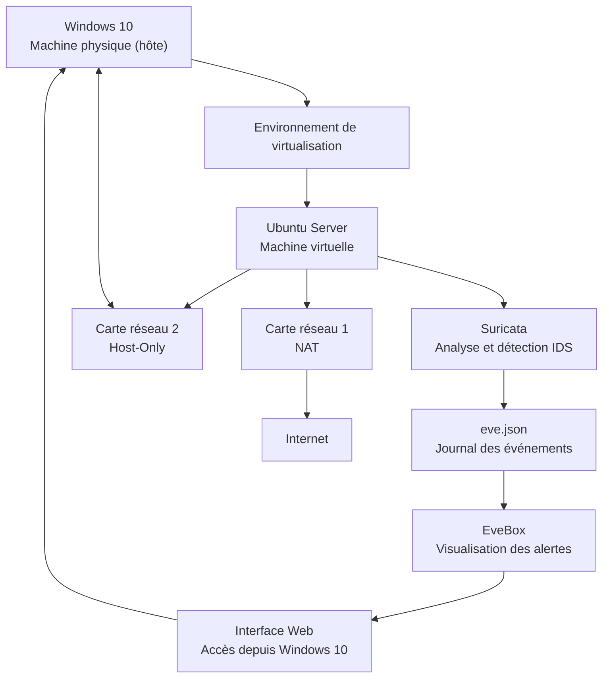

# SOC-detection-engineering-Suricata

## 1. Présentation du projet

Ce projet consiste à mettre en place un mini laboratoire SOC (Security Operations Center) permettant de surveiller le trafic réseau, de détecter des activités suspectes et de visualiser les événements de sécurité à l'aide de **Suricata** et **EveBox**.

L'objectif est de comprendre le fonctionnement d'un système de détection d'intrusion réseau (NIDS) et de mettre en œuvre une solution permettant d'analyser le trafic réseau et d'identifier les activités potentiellement malveillantes.

Le laboratoire repose sur deux environnements :

- **Windows 10 (machine physique)** : ordinateur hôte utilisé pour exécuter l'environnement de virtualisation et accéder à l'interface Web d'EveBox.
- **Ubuntu Server (machine virtuelle)** : serveur hébergeant Suricata et EveBox pour assurer la détection et la supervision des événements réseau.

La machine virtuelle Ubuntu Server dispose de deux interfaces réseau :

- **NAT** : permet à Ubuntu Server d'accéder à Internet.
- **Host-Only** : permet d'établir une communication privée entre Windows 10 et Ubuntu Server.

L'association de Suricata et EveBox permet de mettre en place un environnement de détection, de journalisation et de visualisation des événements de sécurité.

## 2. Objectifs du projet

Les principaux objectifs de ce projet sont :

- Mettre en place un mini environnement de supervision et de détection des intrusions réseau.
- Installer et configurer Suricata sur Ubuntu Server.
- Installer et configurer EveBox pour la visualisation des événements.
- Configurer les interfaces réseau NAT et Host-Only.
- Permettre la communication entre la machine physique et le serveur virtuel.
- Surveiller et analyser le trafic réseau visible par Suricata.
- Identifier les activités correspondant aux règles de détection.
- Exploiter les journaux générés par Suricata.
- Comprendre les principes de fonctionnement d'un IDS et d'un environnement SOC.

## 3. Architecture du laboratoire

### 3.1. Présentation de l'architecture

Le laboratoire repose sur une machine physique fonctionnant sous Windows 10 et une machine virtuelle fonctionnant sous Ubuntu Server.

Windows 10 constitue la machine hôte sur laquelle fonctionne le logiciel de virtualisation. Ubuntu Server est exécuté dans une machine virtuelle et héberge les outils de détection et de supervision.

Deux interfaces réseau sont configurées sur la machine virtuelle afin de répondre à deux besoins distincts : l'accès à Internet et la communication privée avec la machine physique.

### 3.2. Schéma de l'architecture



### 3.3. Configuration réseau

La machine virtuelle Ubuntu Server possède deux cartes réseau configurées dans l'environnement de virtualisation.

| Interface | Mode | Fonction |
|---|---|---|
| Carte réseau 1 | NAT | Accès à Internet depuis Ubuntu Server |
| Carte réseau 2 | Host-Only | Communication privée entre Windows 10 et Ubuntu Server |

**Réseau NAT**

Le mode NAT permet à la machine virtuelle d'utiliser la connexion Internet de la machine physique.

Il permet notamment :
- La mise à jour du système Ubuntu.
- Le téléchargement des paquets nécessaires.
- L'installation des outils de sécurité.
- L'accès aux dépôts logiciels.

**Réseau Host-Only**

Le mode Host-Only crée un réseau privé entre la machine physique Windows 10 et la machine virtuelle Ubuntu Server.

Il permet notamment :
- La communication entre Windows 10 et Ubuntu Server.
- L'accès au serveur Ubuntu depuis la machine physique.
- L'accès à l'interface Web d'EveBox depuis Windows 10.
- L'utilisation d'un réseau privé distinct de la connexion Internet.

### 3.4. Environnement technique

| Composant | Technologie | Fonction |
|---|---|---|
| Machine physique | Windows 10 | Système hôte |
| Machine virtuelle | Ubuntu Server | Serveur de sécurité |
| Carte réseau 1 | NAT | Accès Internet |
| Carte réseau 2 | Host-Only | Communication privée |
| IDS | Suricata | Détection des intrusions réseau |
| Interface de supervision | EveBox | Visualisation des événements |
| Journal des événements | eve.json | Stockage des événements au format JSON |
| Virtualisation | Logiciel de virtualisation | Hébergement de la machine virtuelle |

### 3.5. Rôle des différentes machines

**Windows 10 – Machine physique**

Windows 10 constitue le système d'exploitation de l'ordinateur physique. Il héberge l'environnement de virtualisation dans lequel fonctionne Ubuntu Server.

Il permet également d'accéder à l'interface Web d'EveBox à travers le réseau Host-Only.

**Ubuntu Server – Machine virtuelle**

Ubuntu Server constitue le serveur de sécurité du laboratoire. Il héberge les deux principaux outils utilisés dans le projet.

Ses principales fonctions sont :
- Analyser le trafic visible sur l'interface réseau surveillée avec Suricata.
- Détecter les activités correspondant aux règles de sécurité configurées.
- Générer des événements et des alertes.
- Enregistrer les événements dans le fichier eve.json.
- Fournir les événements à EveBox pour leur visualisation.

## 4. Installation et configuration de Suricata

### 4.1. Présentation de Suricata

Suricata est un outil open source de détection et de prévention des intrusions réseau (IDS/IPS).

Il analyse les paquets réseau et utilise des règles de sécurité pour identifier différentes activités suspectes ou potentiellement malveillantes.

Dans ce projet, Suricata est principalement utilisé comme système de détection d'intrusion réseau (IDS).

### 4.2. Installation

Suricata est installé sur Ubuntu Server.

Les principales étapes comprennent :
- La mise à jour du système.
- L'installation de Suricata.
- La vérification de l'installation.
- L'identification des interfaces réseau.
- La configuration de l'interface destinée à la surveillance.
- L'activation du service.

Commandes principales :

```bash
sudo apt update
sudo apt upgrade -y
sudo apt install suricata -y
```

Vérification de l'installation :

```bash
suricata --build-info
```

Vérification du service :

```bash
sudo systemctl status suricata
```

### 4.3. Configuration de Suricata

Le fichier principal de configuration est :

```text
/etc/suricata/suricata.yaml
```

Ce fichier permet notamment de définir :
- Les interfaces réseau utilisées.
- Les réseaux à surveiller.
- Les paramètres de capture du trafic.
- Les règles de détection.
- Les paramètres de journalisation.

L'interface Host-Only peut être utilisée pour surveiller le trafic échangé entre Windows 10 et Ubuntu Server, à condition que Suricata soit configuré pour écouter cette interface.

### 4.4. Journaux générés

Suricata produit plusieurs fichiers de journalisation.

| Fichier | Description |
|---|---|
| fast.log | Alertes de sécurité sous forme textuelle |
| eve.json | Événements détaillés au format JSON |
| stats.log | Statistiques de fonctionnement |

Le fichier eve.json joue un rôle essentiel dans ce projet, car il permet à EveBox d'exploiter les événements générés par Suricata.

## 5. Installation et configuration d'EveBox

### 5.1. Présentation d'EveBox

EveBox est une interface Web de visualisation et d'analyse des événements générés par Suricata.

Il facilite l'exploitation des journaux de sécurité en proposant une interface permettant de consulter les événements et les alertes détectés.

Dans ce laboratoire, EveBox complète Suricata en offrant une meilleure visibilité sur les activités réseau identifiées.

### 5.2. Installation et configuration

EveBox est installé sur le même serveur Ubuntu que Suricata.

Les principales étapes comprennent :
- L'installation d'EveBox.
- La configuration de la source des événements Suricata.
- La configuration de l'accès à l'interface Web.
- Le démarrage du service.
- La vérification de l'accès à l'interface depuis Windows 10.

EveBox exploite le fichier eve.json pour récupérer les événements produits par Suricata.

### 5.3. Fonctionnalités principales

L'interface EveBox permet notamment de :
- Consulter les alertes générées par Suricata.
- Visualiser les événements réseau.
- Examiner les adresses IP source et destination.
- Identifier les protocoles concernés.
- Consulter les détails des événements détectés.
- Faciliter l'analyse des activités suspectes.

## 6. Fonctionnement général du laboratoire

Le fonctionnement du laboratoire repose sur une succession d'étapes :

1. Ubuntu Server fonctionne dans une machine virtuelle hébergée sur Windows 10.
2. L'interface NAT assure l'accès à Internet.
3. L'interface Host-Only assure la communication privée entre Windows 10 et Ubuntu Server.
4. Suricata analyse le trafic visible sur l'interface configurée pour la surveillance.
5. Les événements correspondant aux règles de détection sont enregistrés dans le fichier eve.json.
6. EveBox exploite les événements produits par Suricata.
7. Depuis Windows 10, l'utilisateur accède à l'interface Web d'EveBox pour consulter et analyser les événements de sécurité.

Cette architecture permet de mettre en place une chaîne de détection, de journalisation et de supervision des événements de sécurité réseau.

## 7. Tests et validation

Le laboratoire a été conçu pour permettre l'observation du trafic réseau et l'analyse des événements générés par Suricata.

L'objectif est de comprendre le processus de surveillance, de détection et de visualisation des activités réseau à travers les outils utilisés.

## 8. Technologies et outils utilisés

| Technologie | Utilisation |
|---|---|
| Windows 10 | Système d'exploitation de la machine physique |
| Ubuntu Server | Système d'exploitation du serveur virtuel |
| Suricata | Détection des intrusions réseau |
| EveBox | Visualisation et analyse des événements |
| NAT | Accès Internet depuis la machine virtuelle |
| Host-Only | Communication privée entre l'hôte et la machine virtuelle |
| JSON | Format de journalisation des événements |
| Virtualisation | Création et gestion de la machine virtuelle |

## 9. Compétences acquises

La réalisation de ce projet m'a permis de développer et de renforcer des compétences dans les domaines suivants :

- Administration d'un serveur Linux Ubuntu.
- Installation et configuration d'outils de cybersécurité.
- Configuration des interfaces réseau NAT et Host-Only.
- Mise en œuvre d'un système de détection d'intrusion réseau.
- Surveillance et analyse du trafic réseau.
- Compréhension des règles de détection IDS.
- Exploitation et analyse des journaux de sécurité.
- Utilisation d'EveBox pour la visualisation des événements.
- Compréhension des principes de fonctionnement d'un environnement SOC.

## 10. Conclusion

Ce projet m'a permis de découvrir et de mettre en pratique les principes fondamentaux de la détection et de la supervision de la sécurité réseau.

L'association de Suricata et EveBox permet de mettre en place un environnement de surveillance capable d'analyser le trafic réseau visible, de détecter des activités correspondant aux règles configurées et de visualiser les événements de sécurité.

La configuration des interfaces NAT et Host-Only permet de séparer l'accès à Internet des communications privées entre la machine physique et le serveur virtuel.

Ce mini laboratoire constitue une expérience pratique dans le domaine de la cybersécurité et contribue au développement de compétences en administration systèmes, réseaux et sécurité informatique.

---

**Technologies utilisées :** Windows 10 | Ubuntu Server | Suricata | EveBox

